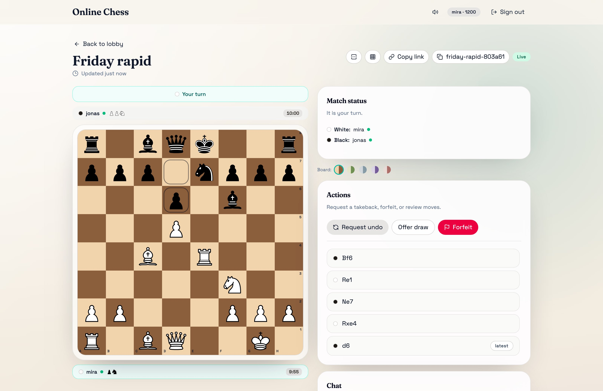
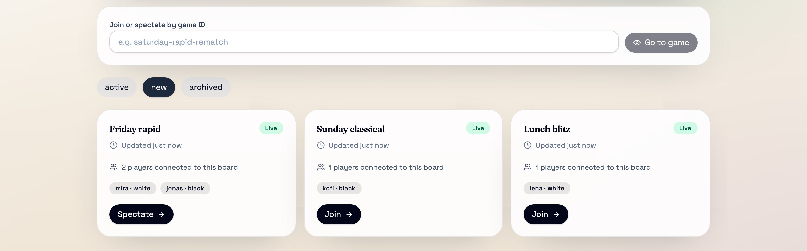
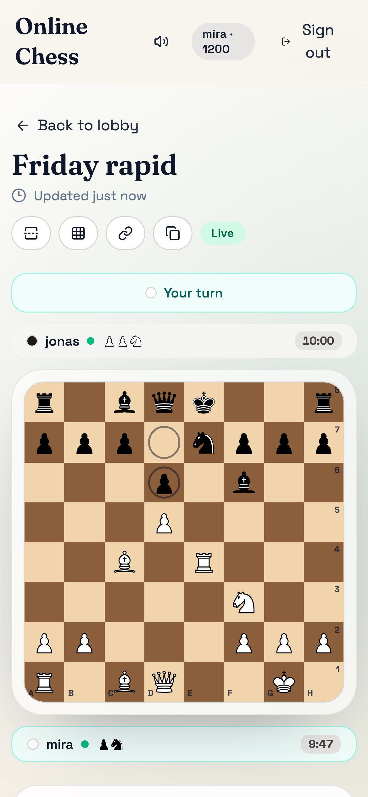

# Online Chess

[](https://github.com/trebeljahr/chess-app/actions/workflows/build-and-deploy.yml)
[](LICENSE)

Play chess with a friend in the browser. Create a game, send your friend the link, and each move shows up on both boards as soon as it is made.

Pick a side and a clock, from one-minute bullet to 30-minute classical, or play with no clock at all. During the game you can chat, offer a draw or ask for a takeback. When it ends, start a rematch or download the game as PGN.

Play at **[chess.trebeljahr.com](https://chess.trebeljahr.com)**. You sign up with a username and a password, no email address.



## What you can do

- **Play live.** Moves, clocks, chat and the online dots of both players update over a WebSocket. Nobody reloads. After a dropped connection the board catches up to the current position.
- **Choose a time control:** no limit, 1+0, 3+0, 3+2, 5+0, 5+3, 10+0, 15+10 or 30+0.
- **Play by the full rules,** with castling, en passant and promotion to the piece you pick. The game ends in a draw on stalemate, threefold repetition, the fifty-move rule or insufficient material.
- **Pre-move.** Queue your next move while your opponent thinks, and it plays the moment your turn starts.
- Click a piece or drag it. A short sound plays on every move, and the speaker icon mutes it.
- **Agree on takebacks and draws.** Each needs the other player's yes. Forfeit ends the game at once.
- **Look back.** Step through the moves with the arrow keys, and download a finished game as a PGN file.
- **Watch.** The lobby lists games waiting for a second player and games already running. Join one, spectate one, or open any game by its ID.
- **Track your rating.** Every account has an Elo rating that starts at 1200.
- Pick one of five board colours, turn coordinates on or off, and flip the board. The browser tab icon shows whose turn it is.



The layout fits a phone screen, so you can play from your phone against a friend on a laptop.



## Run it locally

You need Node.js 24 or newer and pnpm 10.

```bash
pnpm install
pnpm dev
```

`pnpm dev` starts the API server and the Vite client on two free ports and prints the client URL. Vite sends `/trpc` requests and WebSocket upgrades to the API server. Set `API_PORT` and `PORT` to choose the ports yourself.

Accounts and games go to the SQLite file `data/chess.db`. Set `CHESS_DB_FILE` to use another file. Without `REDIS_URL`, the server passes live updates around in its own process, which is all a single server needs.

Checks and a production build:

```bash
pnpm typecheck
pnpm test:game       # move history, undo, repetition, game storage
pnpm test:security   # login limits, password hashing, input validation
pnpm build           # client to dist/client, server to dist/server
pnpm smoke:health    # starts the built server and a local client stand-in, probes /health and /healthz
```

## How it runs in production

The web client is a static Vite build on the Cloudflare Worker `chess-app-client` ([`wrangler.jsonc`](wrangler.jsonc)). The API server is a Docker image that Coolify runs, and `/trpc` on the same host reaches it over HTTP and WebSocket. Every push to `main` runs [`build-and-deploy.yml`](.github/workflows/build-and-deploy.yml). The release steps, secrets and rollout gate are in [docs/coolify-deployment.md](docs/coolify-deployment.md).

## Project layout

```
src/features/   lobby, game page and board, sign-in, privacy and imprint pages
src/shared/     chess rules, used by both client and server
src/server/     Express + tRPC API, WebSocket subscriptions, SQLite through Drizzle
public/         piece images, move sound, favicons, Worker headers and redirects
scripts/        dev runner, smoke test, Worker asset prep, marketing captures
tests/          node:test suites
docs/           deployment, security notes, project history, marketing assets
```

## Tech stack

React 19, TypeScript, Vite and Tailwind CSS 4 in the browser. tRPC 11 with WebSocket subscriptions and TanStack Query between client and server. Express on Node.js 24, Drizzle ORM on SQLite (better-sqlite3), and optional Redis pub/sub when more than one server runs.

The app started in 2019 on Create React App and Meteor. [docs/history.md](docs/history.md) covers the move to this stack.

## License

The code is licensed under the [GNU Affero General Public License v3.0 or later](LICENSE). If you run a changed version for other people over a network, you must offer them its source.

These files are not covered by that licence:

- **Chess pieces** (`public/pieces-basic-svg/`): by Uray M. János ([Green Chess](https://greenchess.net/info.php?item=downloads)), after Colin M. L. Burnett's pieces on Wikimedia Commons, under [CC BY-SA 3.0](https://creativecommons.org/licenses/by-sa/3.0/). Each file keeps its original header.
- **Fonts:** Space Grotesk and Fraunces load from Google Fonts under the [SIL Open Font License 1.1](https://openfontlicense.org). They are not part of this repository.
- **Images made for this project** (the screenshots and cards in `docs/marketing/`): © Rico Trebeljahr, all rights reserved. The chess pieces in them keep their CC BY-SA 3.0 licence.
- **Move sound** (`public/move.mp3`) and **`public/favicon.ico`**: their source is not recorded, so no licence is offered for them here.

## Support

Online Chess is free and shows no ads. To support it and Rico's other free projects: [ricos.site/donate](https://ricos.site/donate).
